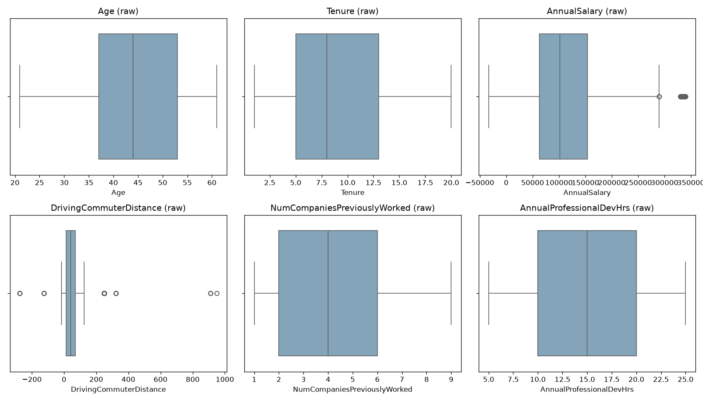
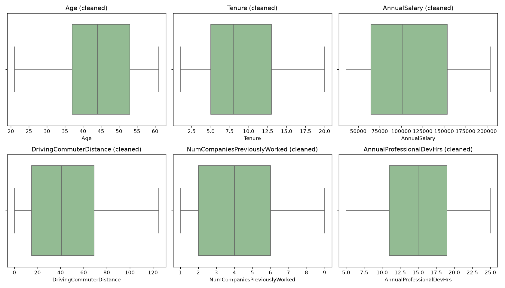

# Employee Turnover: Data Profiling and Cleaning

Profiling and cleaning a raw HR dataset of 10,199 employee records in Python to prepare it for turnover analysis and predictive modeling.

**Tools:** Python 3.12 · pandas · NumPy · Matplotlib · seaborn

📄 **[Read the full report (PDF)](reports/Employee_Turnover_Data_Cleaning_Report.pdf)**

---

## Business Problem

A technology firm is seeing rising employee turnover and wants to identify which employees are most likely to leave so it can target retention efforts. Before any modeling could begin, the raw HR data needed to be profiled, checked for quality problems, and cleaned.

## Results at a Glance

| | Raw data | Cleaned data |
|---|---|---|
| Records | 10,199 | 10,100 |
| Variables | 16 | 16 |
| Duplicate rows | 99 | 0 |
| Missing values | 4,900 | 0 |
| Negative salaries | 57 | 0 |
| Negative commute distances | 1,351 | 0 |
| Distinct PaycheckMethod labels | 7 | 2 |

## Data Quality Issues and Fixes

| Issue | What I found | How I fixed it |
|---|---|---|
| **Duplicates** | 99 exact duplicate employee records | Removed with `drop_duplicates()` |
| **Missing values** | Gaps in 3 columns (6.5%–22.2% of rows) | Median for numeric counts; `"Unknown"` for text-message opt-in |
| **Inconsistent entries** | Variant spellings (`Human_Resources`, `DirectDeposit`); 2,149 salaries that didn't match the hourly rate | Mapped variants to standard labels; recalculated salary as hourly rate × 40 × 52 |
| **Formatting errors** | Hidden space in a column name; hourly rate stored as text (`"$24.37 "`) | Stripped whitespace; converted to numeric types |
| **Outliers** | Commute distances from −275 to 950 miles | Absolute value for sign errors; IQR method with median replacement for extreme values |

Every record was kept. Problems were corrected rather than deleted so the dataset keeps its full size for modeling.


*Numeric variables before cleaning. The salary and commute distance plots show negative and extreme values.*


*The same variables after cleaning.*

## Project Structure

```
├── data/
│   ├── employee_turnover.csv            # raw dataset (unchanged)
│   └── employee_turnover_cleaned.csv    # cleaned output
├── images/                              # before/after boxplots
├── reports/                             # data cleaning report (.docx and .pdf)
├── scripts/
│   └── data_cleaning_profiling.py       # profiling, detection, and cleaning script
├── requirements.txt
└── README.md
```

## How to Run

```bash
git clone https://github.com/ebirdsong88-dev/data-cleaning-and-profiling.git
cd data-cleaning-and-profiling
python -m venv venv
venv\Scripts\activate          # macOS/Linux: source venv/bin/activate
pip install -r requirements.txt
python scripts/data_cleaning_profiling.py
```

The script prints each profiling, detection, and cleaning step to the terminal, then writes the cleaned CSV to `data/` and the boxplots to `images/`.

## Skills Demonstrated

- Data profiling: classifying variables by type and subtype
- Data quality assessment across duplicates, missing values, consistency, formatting, and outliers
- Cleaning with pandas: imputation, category standardization, type conversion, and IQR-based outlier treatment
- Logical validation (cross-checking salary against hourly rate)
- Reproducible, documented workflow with Git version control

## Author

**Earl Birdsong**: [GitHub](https://github.com/ebirdsong88-dev)
